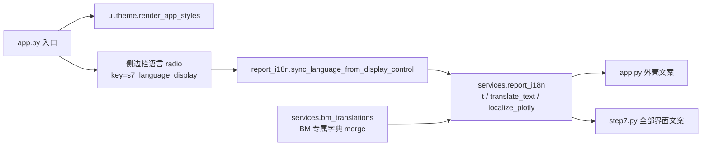

## 产品概述

参照 `app-gi.py` 的架构改造 `bm-platform/app.py`：接入用户已提供的 `ui/theme.py` KPMG 网页样式，并复用 `services/report_i18n.py` 实现中英文一键切换（侧边栏顶部横排 radio「中文 / English」，默认中文），覆盖 app.py 外壳与 step7.py 全部界面文案。

## 核心功能

- 侧边栏顶部语言切换控件（key=`s7_language_display`，与 app-gi.py 一致），切换先于页面绘制同步，立即生效无需二次刷新
- 登录页、顶部状态栏、页签、按钮、Step 6 面板文案随语言显示中/英文
- Step 7 公司级对标报告全部界面文案支持中/英：侧边栏控件、HTML 汇总表、约 30 个图表模块的标题/轴标题/图例/悬停提示、notes_dict 注释、下载按钮等
- AI 点评按当前语言要求模型输出对应语种
- 主界面样式替换为 ui/theme.py 的 KPMG 蓝色系平台级 CSS 与打印样式；暗色登录页 CSS 保留仅文案双语化

## 边界

- 不整体套用 app-gi.py 编排（其依赖 step7_solvency、config/ 等不存在资源）；仅复用自包含的 ui/theme.py 与 report_i18n.py
- 不修改用户提供的 services/report_i18n.py，bm 专属翻译通过新建补充字典模块合并注入
- step8.py 维持中文不翻译；数据字段名（如“保险服务收入合计”“CSM期末余额”）为数据列名不翻译，仅翻译展示文案
- 中文模式下所有文案与现状完全一致（t() 中文恒等返回，零回归风险）

## 技术栈

- 现有项目：Streamlit + Plotly（app.py 入口编排 + step7.py 单文件实现）
- 新增：`services/bm_translations.py` 纯 Python 补充字典模块，无第三方依赖

## 实现方案

### 关键设计决策

1. **复用 report_i18n.py 双参数 t(zh, en) 接口**：每处文案就地写中英对照，中文恒等返回、英文返回英译并对结果做公司名替换；比“中文原文查字典”更直接，避免大规模重构 f-string。
2. **语言同步先于绘制**（等价 app-gi.py `_sync_language_before_paint`）：登录后、主界面绘制前调用 `report_i18n.sync_language_from_display_control()`，从 `st.session_state["s7_language_display"]` 读取并 `set_language`，避免切换需下一次 rerun 才刷新。
3. **样式替换**：删除 app.py line 439-480 旧灰蓝 CSS，改为 `from ui.theme import render_app_styles, render_analysis_tab_styles`；theme.py 自包含（仅 import streamlit）可直接复用；暗色登录页自包含 CSS 保留，仅文案 t() 化。
4. **bm 专属翻译补充模块**（不动用户文件）：新建 `services/bm_translations.py`，定义 BM_PHRASE_EN 等字典并在导入时 merge 进 report_i18n 的对应字典（如 `report_i18n.PHRASE_EN.update(BM_PHRASE_EN)`）；app.py 与 step7.py 导入 bm_translations 触发注册。
5. **图表兜底翻译**：各 Plotly 图构建/渲染处统一调用 `i18n.localize_plotly(fig)`，自动翻译标题/坐标轴/注释/trace 名称/hovertemplate；动态拼接句与 notes_dict 走 `i18n.translate_text` 字典+短语级翻译。
6. **AI 点评语种适配**：prompt 按 `i18n.is_english()` 追加“请用英文回答”要求。

### 性能与可靠性

- t()/translate_text 均为 O(1) dict 查询或短字符串替换，无缓存需求；localize_plotly 有 try/except 保护不破坏图表
- 分模块分批改造，每批 py_compile 校验；字典未命中文案原样回退中文，不报错

### 架构



### 目录结构

```
bm-platform/
├── services/
│   ├── report_i18n.py        # [REUSE] 用户提供，不修改：语言状态、t(zh,en)、translate_text、localize_plotly 等
│   └── bm_translations.py    # [NEW] bm 专属中英字典（app 外壳 + step7 全部文案），导入时 merge 进 report_i18n 各字典
├── ui/theme.py               # [REUSE] 直接复用不改：render_app_styles / render_analysis_tab_styles
├── app.py                    # [MODIFY] 接入 theme 样式替换旧 CSS；侧边栏顶部语言 radio；绘制前同步语言；外壳文案 t(zh,en) 双语化（登录页/标题/页签/按钮/Step6 面板）
└── step7.py                  # [MODIFY] 顶部 import i18n；侧边栏控件/汇总表/图表标题轴图例悬停/notes_dict/按钮提示分批 t() 与 translate_text 包裹；图表返回前 localize_plotly 兜底；AI prompt 语种适配
```

## 执行要点

- step7.py 约 5306 行、文案数百条，按模块分批（侧边栏→汇总表→图表→notes→按钮），每批完成即 py_compile，避免一次大改引入语法错误
- app.py 的 Step6 内联实现（line 628-1100 与 line 1102+ 两版）界面文案同批双语化
- 打印导出路径不受影响；运行验证中文模式与现状一致、英文模式覆盖登录页/页签/Step7 各模块

## Agent Extensions

### SubAgent

- **code-explorer**
- Purpose：梳理 step7.py（约 5306 行）与 app.py 中所有用户可见中文文案，按类别（侧边栏控件/汇总表/图表模块/notes_dict/按钮提示/AI prompt）输出带行号清单
- Expected outcome：得到分类文案清单，作为 t() 包裹与 bm_translations.py 英译字典编制依据，避免遗漏